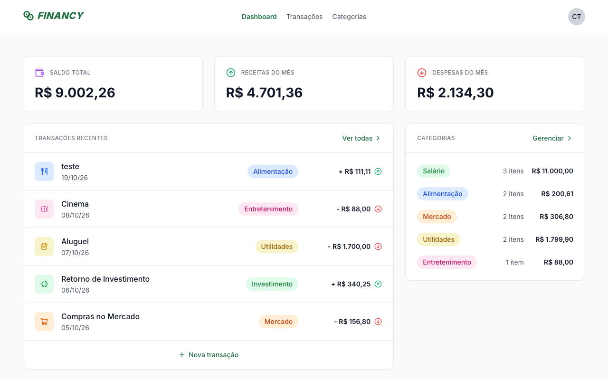
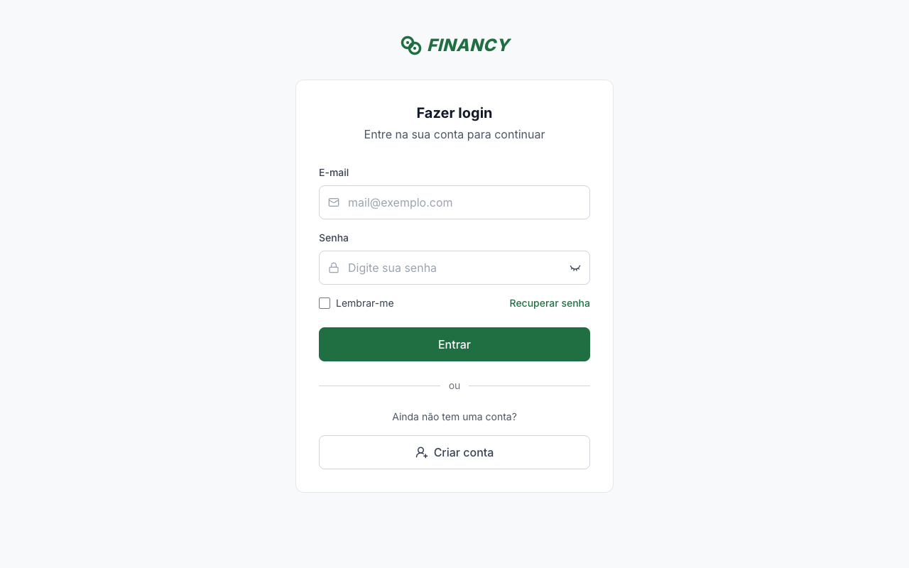
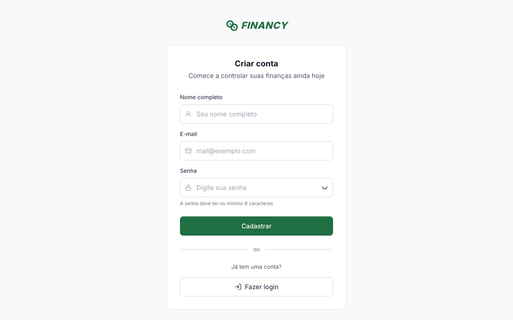
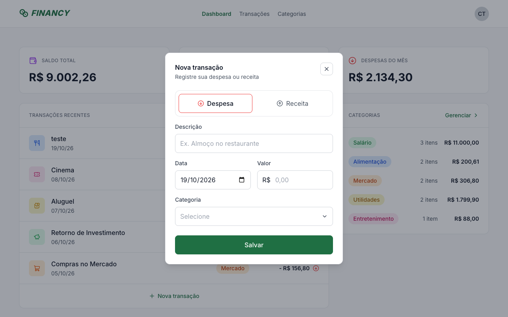
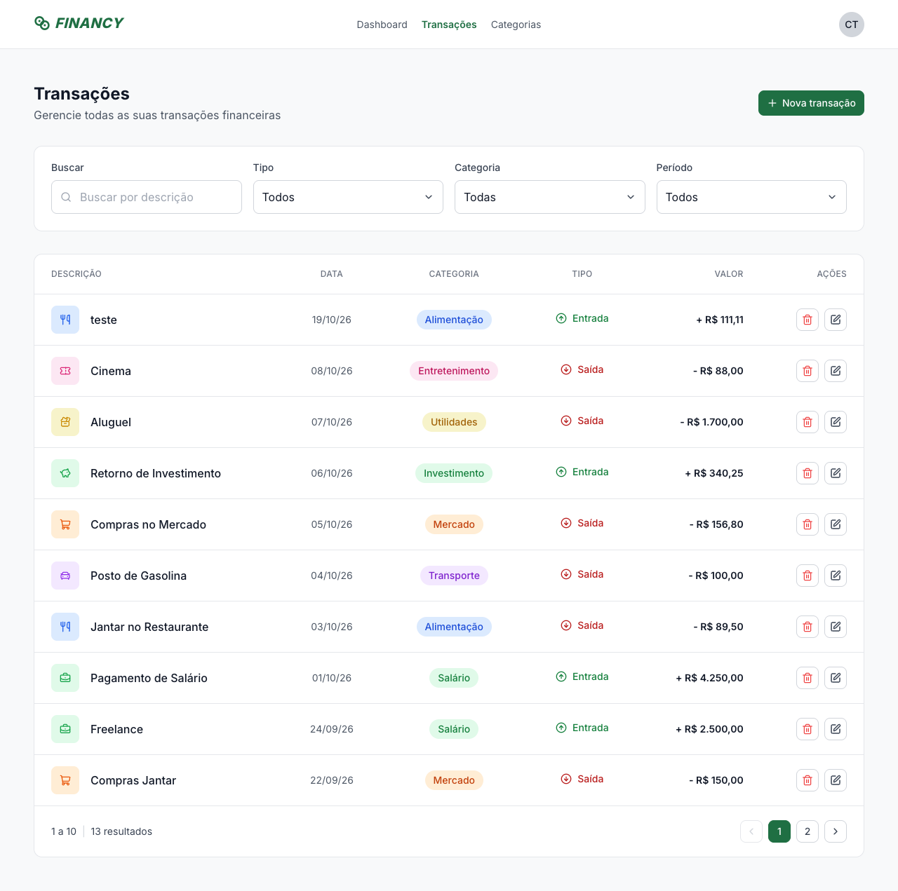
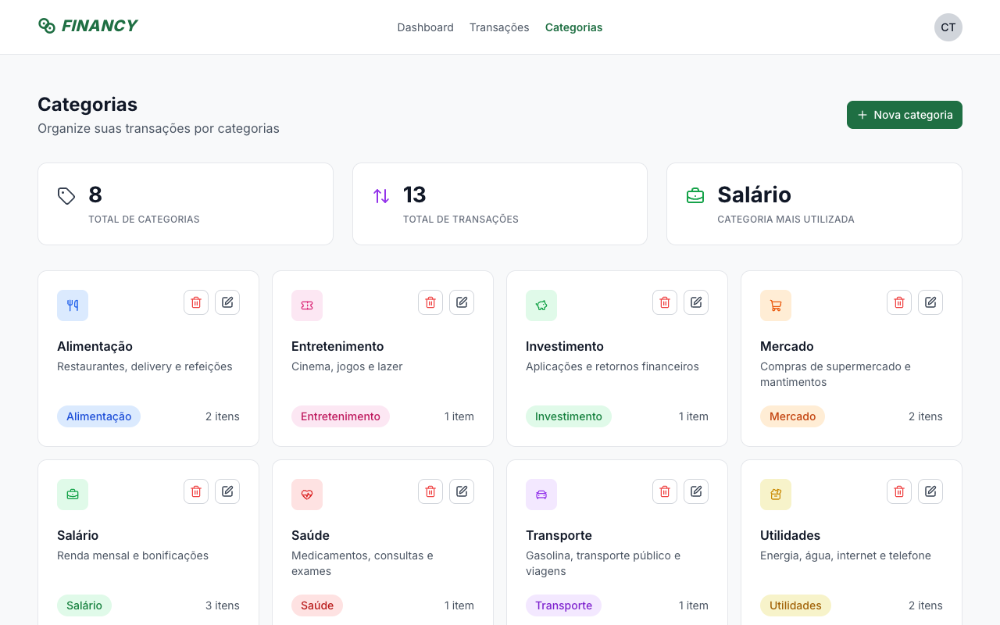
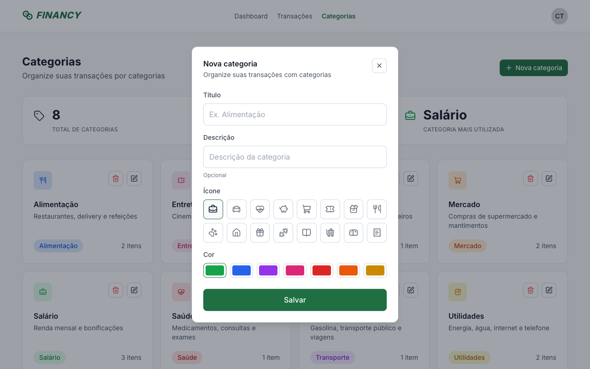
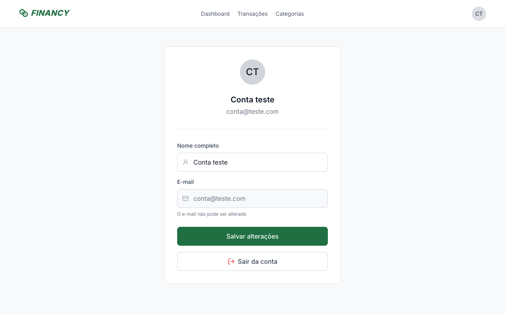

<p align="center">
  <a href="https://www.rocketseat.com.br">
    
  </a>
</p>

<h1 align="center">Financy</h1>

<p align="center">
  Aplicação de organização de finanças pessoais, com gestão de transações e categorias.<br />
  Desafio prático do curso de pós-graduação <strong>Tech Developer 360</strong> da <strong>Faculdade de Tecnologia Rocketseat</strong>.
</p>

<p align="center">
  
  
  
  
  
  
  
</p>

<p align="center">
  <a href="#-sobre-o-projeto">Sobre</a> •
  <a href="#-o-desafio">O desafio</a> •
  <a href="#-funcionalidades">Funcionalidades</a> •
  <a href="#-telas">Telas</a> •
  <a href="#-tecnologias">Tecnologias</a> •
  <a href="#-como-executar">Como executar</a> •
  <a href="#-api-graphql">API GraphQL</a>
</p>

<p align="center">
  
</p>

---

## 💜 Sobre o projeto

O **Financy** é um site desktop de organização de finanças. O usuário cria sua conta, cadastra categorias (com ícone e cor) e registra suas receitas e despesas, acompanhando tudo em um dashboard com saldo total, movimentação do mês, transações recentes e resumo por categoria.

O repositório é dividido em duas aplicações:

| Pasta                    | Descrição                                                          |
| ------------------------ | ------------------------------------------------------------------ |
| [`backend`](./backend)   | API GraphQL com autenticação JWT, Prisma e banco SQLite            |
| [`frontend`](./frontend) | Aplicação React (Vite) que consome a API via GraphQL               |

## 🎯 O desafio

Desenvolver uma API e uma aplicação web que, juntas, permitam o gerenciamento de transações e categorias, seguindo o layout disponibilizado no Figma.

### Requisitos funcionais

Back-end e front-end atendem às mesmas regras:

- [x] O usuário pode criar uma conta e fazer login
- [x] O usuário pode ver e gerenciar apenas as transações e categorias criadas por ele
- [x] Deve ser possível criar uma transação
- [x] Deve ser possível deletar uma transação
- [x] Deve ser possível editar uma transação
- [x] Deve ser possível listar todas as transações
- [x] Deve ser possível criar uma categoria
- [x] Deve ser possível deletar uma categoria
- [x] Deve ser possível editar uma categoria
- [x] Deve ser possível listar todas as categorias

Específicos do front-end:

- [x] Aplicação React usando GraphQL para consultas na API e Vite como bundler
- [x] Seguir o mais fielmente possível o layout do Figma

### Requisitos não funcionais

- [x] **Back-end:** TypeScript, GraphQL, Prisma e SQLite
- [x] **Front-end:** TypeScript, React, Vite (sem framework) e GraphQL
- [x] CORS habilitado na API
- [x] Arquivos `.env.example` com as variáveis necessárias em cada aplicação

## ✨ Funcionalidades

- **Autenticação** — cadastro e login com senha criptografada (bcrypt) e token JWT; rotas privadas no front-end
- **Dashboard** — saldo total, receitas e despesas do mês, últimas transações e categorias mais utilizadas
- **Transações** — criação, edição e exclusão via modal; listagem com busca por descrição, filtros por tipo, categoria e período, e paginação
- **Categorias** — criação, edição e exclusão com escolha de ícone e cor; indicadores de total de categorias, total de transações e categoria mais utilizada
- **Perfil** — edição do nome e saída da conta
- **Isolamento de dados** — toda consulta e mutação é filtrada pelo usuário autenticado

## 🖼 Telas

| Login | Cadastro |
| :---: | :---: |
|  |  |

| Dashboard | Nova transação |
| :---: | :---: |
|  |  |

| Transações | Categorias |
| :---: | :---: |
|  |  |

| Nova categoria | Perfil |
| :---: | :---: |
|  |  |

## 🚀 Tecnologias

**Back-end**

- [TypeScript](https://www.typescriptlang.org/)
- [Apollo Server](https://www.apollographql.com/docs/apollo-server) + [Express](https://expressjs.com/)
- [GraphQL](https://graphql.org/)
- [Prisma](https://www.prisma.io/) com [SQLite](https://www.sqlite.org/)
- [JSON Web Token](https://github.com/auth0/node-jsonwebtoken) e [bcryptjs](https://github.com/dcodeIO/bcrypt.js)
- [Zod](https://zod.dev/) para validação de entradas e variáveis de ambiente

**Front-end**

- [React](https://react.dev/) + [TypeScript](https://www.typescriptlang.org/)
- [Vite](https://vite.dev/)
- [Apollo Client](https://www.apollographql.com/docs/react)
- [Tailwind CSS](https://tailwindcss.com/)
- [React Router](https://reactrouter.com/)
- [React Hook Form](https://react-hook-form.com/) + [Zod](https://zod.dev/)
- [Radix UI Dialog](https://www.radix-ui.com/primitives/docs/components/dialog)
- [Lucide Icons](https://lucide.dev/) e [Sonner](https://sonner.emilkowal.ski/)

## 💻 Como executar

### Pré-requisitos

- [Node.js](https://nodejs.org/) 20 ou superior
- npm

### 1. Clonar o repositório

```bash
git clone https://github.com/brunolmartinsbemn/financy.git
cd financy
```

### 2. Back-end

```bash
cd backend
cp .env.example .env    # preencha o JWT_SECRET
npm install
npx prisma migrate dev  # cria o banco SQLite e popula com dados de exemplo
npm run dev             # http://localhost:4000/graphql
```

| Variável       | Descrição                                                  | Exemplo                 |
| -------------- | ---------------------------------------------------------- | ----------------------- |
| `JWT_SECRET`   | Segredo utilizado para assinar os tokens                   | `uma-chave-secreta`     |
| `DATABASE_URL` | URL de conexão do banco SQLite                             | `file:./dev.db`         |
| `PORT`         | Porta da API (opcional, padrão `4000`)                     | `4000`                  |
| `CORS_ORIGIN`  | Origens permitidas, separadas por vírgula, ou `*` (opcional) | `http://localhost:5173` |

O seed cria um usuário de demonstração já com categorias e transações:

```
E-mail: conta@teste.com
Senha:  12345678
```

### 3. Front-end

Em outro terminal:

```bash
cd frontend
cp .env.example .env    # VITE_BACKEND_URL=http://localhost:4000/graphql
npm install
npm run dev             # http://localhost:5173
```

| Variável           | Descrição                    | Exemplo                         |
| ------------------ | ---------------------------- | ------------------------------- |
| `VITE_BACKEND_URL` | Endpoint GraphQL da API      | `http://localhost:4000/graphql` |

### Scripts úteis

| Aplicação | Script               | Descrição                                  |
| --------- | -------------------- | ------------------------------------------ |
| backend   | `npm run dev`        | Sobe a API em modo de desenvolvimento      |
| backend   | `npm run build`      | Compila o TypeScript para `dist/`          |
| backend   | `npm run db:seed`    | Recria o usuário de demonstração           |
| backend   | `npm run db:studio`  | Abre o Prisma Studio                       |
| frontend  | `npm run dev`        | Sobe a aplicação em modo de desenvolvimento |
| frontend  | `npm run build`      | Gera o build de produção                   |

## 🔌 API GraphQL

Endpoint: `POST /graphql`. Operações autenticadas exigem o header `Authorization: Bearer <token>`.

| Tipo     | Operação                                         | Descrição                                     |
| -------- | ------------------------------------------------ | --------------------------------------------- |
| Mutation | `register(data)`                                 | Cria a conta e retorna token + usuário        |
| Mutation | `login(data)`                                    | Autentica e retorna token + usuário           |
| Query    | `me`                                             | Dados do usuário autenticado                  |
| Mutation | `updateProfile(data)`                            | Atualiza o nome do usuário                    |
| Query    | `categories`                                     | Lista as categorias com quantidade e total    |
| Mutation | `createCategory` / `updateCategory` / `deleteCategory` | Gestão de categorias                    |
| Query    | `transactions(filter, page, perPage)`            | Lista paginada com busca e filtros            |
| Mutation | `createTransaction` / `updateTransaction` / `deleteTransaction` | Gestão de transações           |
| Query    | `summary(period)`                                | Saldo total e receitas/despesas do mês        |

Exemplo:

```graphql
query {
  transactions(filter: { type: EXPENSE, period: "2025-11" }, page: 1, perPage: 10) {
    total
    items {
      description
      amount
      date
      category { title }
    }
  }
}
```

> Valores monetários trafegam em centavos (`Int`) para evitar erros de arredondamento. Ao excluir uma categoria, as transações vinculadas permanecem, apenas sem categoria.

### Modelo de dados

```
User 1 ── N Category 1 ── N Transaction
User 1 ── N Transaction
```

---

<p align="center">
  Desenvolvido por <strong>Bruno Emmanuel Martins do Nascimento</strong> durante a pós-graduação Tech Developer 360 da Faculdade de Tecnologia Rocketseat 💜
</p>
